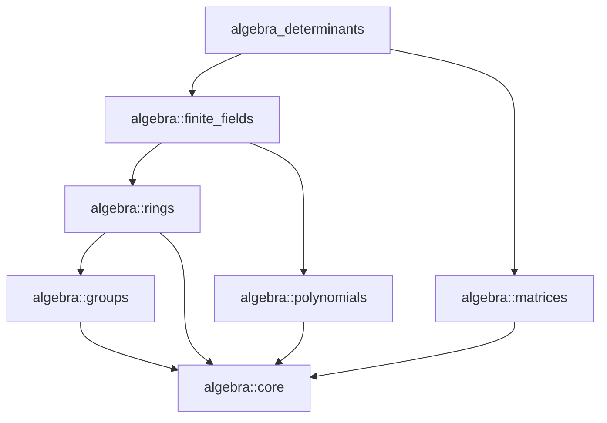

# Finite field caching dependency map

The cache belongs at the finite field element boundary in `algebra-finite-fields`.
The matrix library operates on a generic element type, so a compatible replacement
can serve both matrix multiplication and the determinant algorithm without
changing their arithmetic code. This map records the original interfaces and
dependency revisions to preserve before implementing the cache.

## Dependency graph

Arrows mean a CMake target depends on another target. All six algebra libraries
are header-only `INTERFACE` targets at the inspected revisions.

The application pins its two direct dependencies in
[Dependencies.cmake](../cmake/Dependencies.cmake). Their dependency declarations
pin the remaining libraries. Shared dependencies resolve to the same revisions.

| Repository | Pinned revision | Role |
| --- | --- | --- |
| [algebra-finite-fields](https://github.com/nathanjrussell/algebra-finite-fields/tree/74b3d569fb48818f4c10f3c32889f2128485f1a7) | `74b3d569fb48818f4c10f3c32889f2128485f1a7` | Extension field elements, prime field coefficients, modulus selection |
| [algebra-matrices](https://github.com/nathanjrussell/algebra-matrices/tree/84abddac26d2805072efcb1c44bbe7faac45fa6b) | `84abddac26d2805072efcb1c44bbe7faac45fa6b` | Matrices over generic ring elements |
| [algebra-rings](https://github.com/nathanjrussell/algebra-rings/tree/2a11ac8b8ea89d9ccf2ce551a8512dde213fde50) | `2a11ac8b8ea89d9ccf2ce551a8512dde213fde50` | Residue arithmetic beneath prime field coefficients |
| [algebra-polynomials](https://github.com/nathanjrussell/algebra-polynomials/tree/068f53f336d9ee9067f4fc419bc1dc6b83f4618f) | `068f53f336d9ee9067f4fc419bc1dc6b83f4618f` | Polynomial storage and arithmetic |
| [algebra-groups](https://github.com/nathanjrussell/algebra-groups/tree/3fb89f9178d775518d731a56bfebe7c3f2f84e52) | `3fb89f9178d775518d731a56bfebe7c3f2f84e52` | Cyclic additive groups used by residue elements |
| [algebra-core](https://github.com/nathanjrussell/algebra-core/tree/df491678e274372fb0a08914c61a4d504414a739) | `df491678e274372fb0a08914c61a4d504414a739` | Concepts, descriptors, structures, and operator adapters |

## Where the work happens

[main.cpp](../src/main.cpp) selects `algebra::FiniteField<11, 3>`, uses its nested
`Element` type, and creates `algebra::Matrix<Element, N, N>`. Matrix multiplication
repeatedly calls the element's `multiply()` and `add()` methods. The determinant
function is now extracted into the shared
[determinant.hpp](../include/determinant.hpp); it also calls `reciprocal()`,
`negate()`, and zero/one checks during elimination.

The original
[FiniteFieldElement implementation](https://github.com/nathanjrussell/algebra-finite-fields/blob/74b3d569fb48818f4c10f3c32889f2128485f1a7/include/algebra/finite_fields/finite_field.hpp)
stores a polynomial. Addition and multiplication create polynomial results and
reduce them modulo the field's defining polynomial. Reciprocals use the extended
Euclidean algorithm on polynomials. Even coefficient arithmetic crosses the
prime field, residue ring, and cyclic group layers. Reusing a previous field
operation's result can avoid that repeated work. Profiling in card 04 will
establish the actual runtime distribution.

The matrix library depends directly on core concepts rather than the finite
field library. The application connects them through the template element type.
This is why preserving the field element interface is sufficient for the
existing matrix operations to keep working.

## Replacement boundary

The primary class to wrap is
`algebra::FiniteFieldElement<P, K, ModulusPolicy>`, exposed through
`algebra::FiniteField<P, K, ModulusPolicy>::Element`. Preserve both public names
and their relationship. The template defaults are `K = 1` and
`ModulusPolicy = FirstEnumeratedIrreducible` on `FiniteField`.

Both providers expose `algebra::finite_fields`: an alias for
`algebra_finite_fields` in the original backend or `algebra_finite_fields_cached`
in the cached backend. Both preserve the public include paths:

- `algebra/finite_fields/finite_fields.hpp`
- `algebra/finite_fields/finite_field.hpp`
- `algebra/finite_fields/prime_field.hpp`
- `algebra/finite_fields/modulus.hpp`
- `algebra/finite_fields/enumeration.hpp`

The direct dependency is declared before the matrix dependency in
[Dependencies.cmake](../cmake/Dependencies.cmake). The cache setting
`ALGEBRA_ASSIGNMENT_BACKEND=original` or `cached` selects the provider while
preserving the target used by
[the executable](../src/CMakeLists.txt). The accepted
[cache design](./cache-design.md) retains the original classes under internal
names while exposing the public names above. Its cache misses call that original
arithmetic, and modulus selection remains unchanged. The public wrapper and
provider integration are implemented. Both Release configurations pass the
five-target suite and seeded reference checks; see the
[initial timing comparison](../results/backend-check/README.md).

## Public interface to preserve

| Surface | Existing interface |
| --- | --- |
| Field metadata | `Element`, `Base`, `PolynomialType`, `characteristic`, `extension_degree`, `cardinality()` |
| Field initialization | Default constructor, `initialize()`, `modulus()` returning `const PolynomialType&` |
| Field construction helpers | `element(integer)`, `element(coefficients)`, `zero()`, `one()`, `alpha()` |
| Element metadata | `parent_type`, `algebra`, `coefficient_type`, `polynomial_type` |
| Element construction | Default constructor, `from_integer()`, `from_index()`, `from_coefficients()`, `from_polynomial()`, `zero()`, `one()` |
| Element arithmetic | `add()`, `negate()`, `multiply()`, `reciprocal()` |
| Element observation | `is_zero()`, `is_one()`, `coefficient()`, `coefficients()`, `representative()`, `parent()`, equality, stream output |
| Operators | `+`, binary/unary `-`, `*`, `/`, and compound assignments through the existing adapters |
| Generic compatibility | Copyable element, field descriptor, valid parent type, and the existing core field concepts and structure interfaces |

The application explicitly checks `FieldElement<Element>` and
`RingElement<Matrix>` at compile time. Preserving only a few method names is not
enough if the descriptors, aliases, or return types change. In particular,
`representative()` currently returns `const polynomial_type&`; a temporary
polynomial cannot satisfy its reference lifetime.

## Mathematical behavior and tests to retain

Elements have the form `a0 + a1*x + a2*x^2`, with each coefficient in `0..10`.
There are `11^3 = 1331` elements. The existing deterministic search selects
`x^3 + x + 4`. This polynomial is explicitly expected by the upstream
[finite field tests](https://github.com/nathanjrussell/algebra-finite-fields/blob/74b3d569fb48818f4c10f3c32889f2128485f1a7/test/finite_field_test.cpp).
Keep the search and verify this result when running the original baseline.

An element can be labeled by `a0 + 11*a1 + 121*a2`, giving labels `0..1330`.
This is a candidate cache-key encoding, not a replacement for the integer
embedding:

- `Element::from_integer(11)` is zero because integers embed into the prime
  subfield modulo 11.
- `Element::from_index(11)` is `x` because the index is decoded into base-11
  polynomial coefficients.
- `Element::from_polynomial()` reduces arbitrary input polynomials modulo the
  selected irreducible polynomial.
- The reciprocal of zero throws `std::domain_error`; `/` invokes reciprocal
  through the existing adapter.
- An index of 1331 and a coefficient index of 3 are out of range for this field.

These distinctions belong in the equivalence tests. Compare exact coefficients
with the original implementation, then validate matrix products and determinants.
The determinant identity is an additional check alongside known small cases.

Card 03 is complete: the original dimension-8 results are recorded in
[the Kanban](../KANBAN.md), and the shared determinant passes the known small
cases in [the test program](../tests/determinant_tests.tpp). Card 04 has recorded
the original timing, memory, and profile results. The current work implements
the accepted [cache design and checklist](./cache-design.md).
